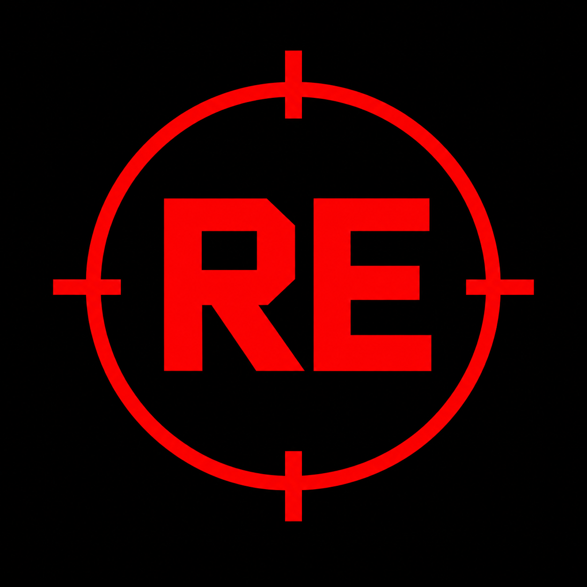

# RE4 Controls for Nintendo Switch



Smooth stick controls and motion aiming for the original Nintendo Switch release
of **Resident Evil 4**. Includes an English/Russian overlay, a standalone installer
and updates from GitHub Releases. English is the default language.

[Download](https://github.com/EscHelpNew/re4-controll-mod/releases/latest) ·
[Русская инструкция](docs/README.ru.md) · [Installation](docs/installation.md)

The current release is **[0.20.0](docs/releases/v0.20.0.md)** (2026-11-07),
including all changes since 0.17.2.

**Game → Enemy health bars** shows a thin translucent green/yellow/red strip
above the enemy under your aim, fading in and out over 300 ms. Optional
**Health numbers** show current health in weapon firepower units, for example
`5.0`. Both options start off and are saved independently of profiles. Game
follows Graphics; both menus include a compact preview that follows the toggles.

This release also adds reload walking and right-stick steering, grenade aim
movement, unified controls and a rear shoulder camera for playable Ashley, stable
character framing during strafe/camera turns, and corrected extreme aim framing.
Select the **RE6** controls profile or enable the corresponding movement options
and **Unified sticks**. Native reload timing is preserved; scopes stay stationary.
It repairs the known legacy installation-receipt conflict while preserving
protection for unknown files from other mods.

Host tests, ARM64 builds and public artifact audits passed. The application
transfer and restart were verified on console; camera/movement behavior was
confirmed in local 0.18.5. Broader gameplay and graphics acceptance remains
incomplete; see the release notes for scope and installation instructions.

## Features

- A separate [RE6 Graphics overlay](docs/re6-graphics.md) with native defaults,
  anisotropic filtering and fixed native FXAA3. Native RE6 gyro is retained.
- Graphics settings for both games in the standalone installer, with illustrated
  help in the installer and overlays. Highlighted areas on official game frames
  show where each option matters; these are not captured comparisons of mod settings.

- A separate [RE6 controls profile](docs/re6-profile.md), based on synchronized
  console measurements: faster overview, slower aiming and a softer stop.
  Basic console comparison in RE4 is accepted; further animation polish is tested separately.

- Read-only RE6 reference observer and the same synchronized journal in RE4.
  A separate [measurement overlay](docs/measurement-ru.md) records raw sticks,
  player/camera matrices and native timestamps with explicit Start/Stop actions.
  Handheld capture and a first RE4 baseline comparison are verified.

- Proportional turning, walking, camera and firearm aiming.
- Separate left/right aiming sensitivities and adjustable stick deadzones.
- Full native stick pitch for knife/firearm aiming; overview keeps its 35-degree band.
- Smooth sniper scoped right-stick/gyro aim and left-stick zoom; scoped play stays stationary.
- Linear, exponential, logarithmic and blended response curves.
- Remap 20 game-visible buttons, including menus and QTE, with swaps, duplicate
  targets or unbound buttons. The overlay keeps its physical controls.
- Adjustable camera return speed and a continuous 360-degree free camera.
- A Graphics menu with Native defaults: bilinear/trilinear/AF2x-16x filtering,
  handheld900p SSAA, loaded-object culling distance and rendered shadows.
- Default/RE6/Custom controls profiles and independent RE4 Default/Custom/Quality
  graphics presets. Manual graphics edits save Custom; selecting Default or Quality
  keeps your last Custom for later restoration.
- Optional first-person view, preserving native scopes and scripted cameras.
- Optional dot/crosshair reticle with three sizes, projected from the weapon ray.
- Optional movement while aiming, using the knife or reloading: left stick moves, right
  stick aims, with native walking motion and leg animation for supported Leon states.
- Additive gyro aiming **only while aiming a firearm**; independent X/Y gains,
  motion speed, calibration and a deadzone in degrees/second.
- Gyro filtering averages two readings separated by 10 ms of sensor time, with continuous output on every fresh sample.
- Controller diagnostics with numeric left/right stick deadzones and a standalone
  gyro test scene with editable settings, live preview and explicit save/cancel.
- Frame-clock interpolation adds10ms presentation delay to avoid uneven sensor-batch steps.
- Motion during ordinary weapon raising is discarded; aiming starts after native readiness without replaying that motion.
- Live settings, help for every control, English/Russian language selection.
- Separate settings groups and a main-menu language selector.
- Live reticle preview while editing its shape or size, with a labelled enlarged sample.
- A standalone installer that creates its own HOME shortcut with the supplied icon.
- RE artwork for the NRO/HOME icon, with the original 4 inside the RE4 page and
  the existing 6 inside the RE6 page.
- Revised exit handling for the own HOME launcher: B from the app's main menu
  or + requests a return to HOME. A failed request keeps the app visible with
  an error code and a retry option. Basic exit was user-confirmed in local 0.17.1.
- In-app HTTPS updates with size, SHA-256, application identity and version checks.

Stick speed is capped at the game's native maximum. Default stick deadzones
are 0.05. Both gyro inversions default to on; gyro aiming defaults to off.
Sensitivity/speed defaults are 1.00, except gyro aiming speed at 0.80.
Existing saved sensitivities are preserved when updating.

The overlay opens separate **Controls** and **Graphics** sections. Each has its
own profile selector; switching one preserves the other, your language and gyro
calibration. An empty Custom profile becomes available after editing a setting.

Controls starts with a profile row, changed with A or Left/Right. The groups are
Sticks, Aiming, Gyro, Camera, Reticle, Button mapping and Reset. Language is selected only on the main menu. In Reticle,
the picture updates as you change form or size; Off shows no marker.

In the standalone app, **Controller diagnostics** shows all four stick axes with
the configured left/right deadzone values. Muted red hatching marks each axis's
zero interval; the stick deadzone is axial. Press **ZL** once to open **Gyro test**,
or choose **Control settings → Gyro → Debug mode**. Motion preview stays active
without holding ZL. The transparent list edits the current gyro enabled state,
speed, deadzone (degrees/second), X/Y gains and X/Y inversions. **X** calibrates a
stationary controller in Gyro test. The eight rows are seven settings and
**Save and apply**. **Y** returns the live red dot to its
default position (810, 350), zeroes the preview angles and clears pending motion;
settings stay unchanged. **Save and apply** validates
and saves the draft, then returns to the exact entry page and selection. **B**
discards the draft and returns there. A save error keeps the test open and the
active settings unchanged; edits and calibration affect only the preview until saved.
Outside Gyro test, diagnostics keeps **Y** for calibration and **X** for preview reset.

Version 0.17.2 corrects the app preview's horizontal direction to match game
aiming. Game gyro behavior, saved inversion settings and sensitivities are
preserved; no settings migration or reset is needed.

The scene is a fixed classic RE4 Leon illustration, edited from an official frame
to remove the baked laser and dot. Only the preview dot moves. Raw motion is shown
in rotations/second and accumulated preview angles in radians at lower left. The
preview uses the game's gyro filter and frame integration; scene projection is
illustrative and does not reproduce the game's world geometry or FOV. See the
[test requirements](docs/testing.md) for pending console acceptance.

The new view, reticle and movement modes start **Off**. Enable them independently
in Controls. First-person view uses Camera sensitivity for continuous right-stick
look. Move while aiming/Move with knife retain the game's attack timing and
collision pipeline. These paths target Leon's ordinary firearms and knife;
verified pistol, shotgun, automatic, rifle, launcher, mine and grenade handlers are supported;
charged-special handlers and other characters' weapon actions are excluded. Scoped
rifle views stay stationary, with leftY zoom and rightXY/gyro aiming. The0.7 native paths
have automated callback tests; console visual/collision acceptance is still pending.

In **Control settings → Button mapping**, select a physical button and its game
target. HOME/Capture belong to the system and are outside game remapping.
**Camera return speed** ranges from 1.00 (native return) to 0.00 (hold the bounded
look angle). **Free camera 360** adds continuous right-stick rotation with no
return, using Camera sensitivity and the chosen curve. Smooth sticks must be on.
Pitch remains within the native vertical range; normal weapon aiming remains separate.

RE4 **Graphics → Graphics profile** offers these independent presets in the
installer and overlay:

| Preset | Texture filtering | Anti-aliasing | Object distance | Shadows |
|---|---|---|---|---|
| Default | Native | Native | 1.00x | Native |
| Custom | Last manual setting | Last manual setting | Last manual setting | Last manual setting |
| Quality | AF16x | Handheld SSAA | 1.75x | Native |

Default restores the original game graphics. Quality uses the existing handheld
SSAA path: 900p rendering downsampled to 720p in handheld mode; docked rendering
stays native. Manually editing graphics saves Custom. Switching to Default or
Quality preserves that configuration so Custom can restore it later.

**For graphics changes to apply fully, close RE4 completely: HOME → X → Close,
then launch the game again.** Returning to the game menu or reopening the overlay
is insufficient; filtering and AA are latched for the game session.

Manual filtering choices include bilinear/trilinear/AF2x–16x. Object distance
scales the loaded room's fog-limited culling range 0.50x–2.00x; it does not load
extra rooms or alter fog/LOD. Shadows can remain Native or be disabled; no
shadow-resolution override is included. Higher settings cost GPU time. Quality
image quality and performance in 0.17.2 still require console validation.

## Supported game

| Item | Supported value |
|---|---|
| Game | Resident Evil 4, original Nintendo Switch port |
| Title ID | `010099A00BC1E000` |
| Main Build ID | `82C2A04A21D3E0B850F273D4149C900300000000000000000000000000000000` |
| Runtime | Atmosphere with `dmnt:cht`; Tesla-compatible overlay loader |
| Tested console firmware | Horizon 22.1.0 with CFW |

The module checks the title, full Build ID and original instructions before
installing hooks. Other builds remain unsupported until their executable is checked.
This is an **experimental homebrew mod**. Special weapons and every scripted/QTE
context have not been exhaustively tested. Game files are not included.

## Install

1. Download `re4-controls.nro` from Releases and copy it to
   `sdmc:/switch/re4-controls/re4-controls.nro`.
2. Close RE4. Open hbmenu in **application mode** by holding R while launching
   an installed title, then start RE4 Controls. It prepares its own HOME shortcut.
3. Choose **Install / update mod**. Keep your existing Uberhand/Tesla installation;
   RE4 Controls installs only its own overlay.
4. Start RE4, open your loader's overlay menu, select **RE4 Controls**, then
   **Connect to game**. Adjust settings and enable gyro if wanted.

The SD ZIP is an alternative manual installation package. Installation and removal
details are in [docs/installation.md](docs/installation.md).

## Update

Open **RE4 Controls → Updates → Check for updates**. If a newer release exists,
choose **Download / install**. Reopen the app after installation, then choose
**Install / update mod** while RE4 is closed to update its bundled game module
and overlay. For RE6, use **Install RE6 module** while RE6 is closed.

For a manual update, including replacement with the same version, close the app
and both games, then replace all three app images from the same release:
`re4-controls.nro`, `bridge.nro` and `game.nro`. Reopen the app and install the
bundled modules again. Saved settings are preserved. See the
[exact paths and update steps](docs/installation.md#manual-update-including-the-same-version).

Updates use the public releases of this repository. No GitHub token or console key
is required. A private repository or missing release produces an unavailable message.
Previous app images are retained; failed validation leaves the current app intact.

## Build and test

Windows build requirements: Python 3.13, devkitA64/libnx, switch-tools, switch-sdl2,
switch-curl and switch-zlib. Host C++ tests use MinGW64 and SDL2.
See [build instructions](docs/building.md) and [test coverage](docs/testing.md).

```powershell
python -m venv .venv
.venv\Scripts\python.exe -m pip install -r requirements-dev.txt
Copy-Item project.release.json project.json
.venv\Scripts\python.exe build.py --test
.venv\Scripts\python.exe build.py --module --overlay --nro
```

The own HOME payload is included in `assets/home-launcher.bin`. Normal NRO builds
need no console keys. Regenerating the forwarder is a separate local packaging step.
Developer LAN reload support uses the pinned
[Switch Debug Kit](https://github.com/EscHelpNew/switch-monitor); its credential is
local and excluded from source and public release assets.

## Contributing and licenses

Include the game Build ID, controller style, settings and reproduction steps in bug
reports. Never attach keys, tokens, game containers or private debug logs.
See [CONTRIBUTING.md](CONTRIBUTING.md) and [CHANGELOG.md](CHANGELOG.md).

Own code: [MIT](LICENSE). The game module uses exlaunch (GPL-2.0), and the overlay
uses libtesla (GPL-2.0-or-later). Complete pinned sources and dependency notices
are in `third_party/`. Release artifacts include their notices.

The built-in **RE6** controls profile combines measured overview/aiming response,
unified sticks, moving aim/knife/reload and gyro. Choose it in the first Controls
row. The left stick moves; the right stick turns and looks. A/B/X/Y and PLUS/MINUS
keep their original actions. Overview stick pitch stops at±35°; firearm/knife
aiming retains the full native range and scopes retain their own pitch limits.
Gyro retains its separate native range. Default restores original controls with gyro off.
Previous RE9 settings remain available as Custom; RE9 is no longer a preset.

The installer also has an **RE6** page, selected with **L/R**, with separate
module/overlay installation, shared language and exit. The supported RE6 update
is v131072, Build ID `061D2A06CD700785E987C42CE2D72231` (zero-padded to32bytes).
Its observer preserves native controls and records the primary single-player
viewport. In **RE4 / RE6 Telemetry**, select the game and use Start recording /
Stop and save. Recording continues while hidden. See the
[repeatable test sequence](docs/measurement-ru.md).

Completed CSVs can be downloaded while the own installer runs:

```powershell
python tools/telemetry_logs.py list
python tools/telemetry_logs.py fetch --output build/telemetry
python tools/telemetry_analyze.py build/telemetry/FILE.csv --output build/telemetry/FILE.json
```

These commands use the existing ignored local credential. The separate read-only
log service exposes only completed telemetry basenames, never arbitrary SD paths.
The first single-player handheld capture was verified with1437 valid samples
and no lost records. Other controller styles, extended sessions and comparison
of the new RE6 preset inside RE4 remain hardware checks.
