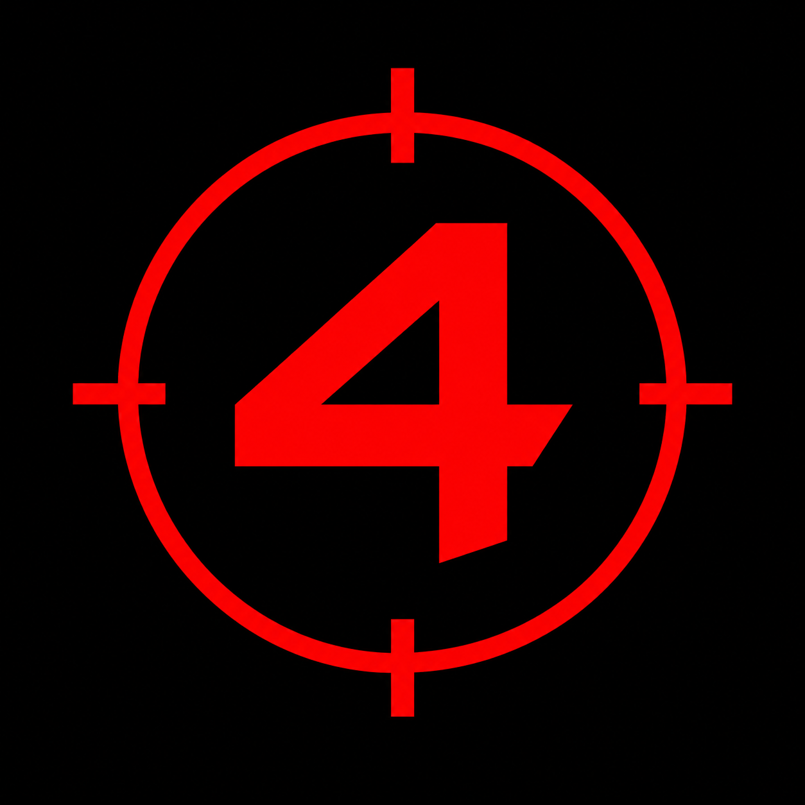

# RE4 Controls for Nintendo Switch



Smooth stick controls and motion aiming for the original Nintendo Switch release
of **Resident Evil 4**. Includes an English/Russian overlay, a standalone installer
and updates from GitHub Releases. English is the default language.

[Download](https://github.com/EscHelpNew/re4-controll-mod/releases/latest) ·
[Русская инструкция](docs/README.ru.md) · [Installation](docs/installation.md)

The current source/local build is **0.7.1, unreleased**. Published Releases may
contain an earlier version while new features are being tested.

## Features

- Proportional turning, walking, camera and firearm aiming.
- Separate left/right aiming sensitivities and adjustable stick deadzones.
- Linear, exponential, logarithmic and blended response curves.
- Remap 20 game-visible buttons, including menus and QTE, with swaps, duplicate
  targets or unbound buttons. The overlay keeps its physical controls.
- Adjustable camera return speed and a continuous 360-degree free camera.
- A Graphics menu with Native defaults: bilinear/trilinear/AF2x-16x filtering,
  handheld900p SSAA, loaded-object culling distance and rendered shadows.
- Independent Default/Custom profiles for controls and graphics. Editing a setting
  saves Custom; selecting Default keeps your last Custom for later restoration.
- Optional first-person view, preserving native scopes and scripted cameras.
- Optional dot/crosshair reticle with three sizes, projected from the weapon ray.
- Optional movement while aiming or using the knife: left stick moves, right
  stick aims, with native walking motion and leg animation for supported Leon states.
- Additive gyro aiming **only while aiming a firearm**; independent X/Y gains,
  motion speed, calibration and a deadzone in degrees/second.
- Gyro filtering averages two readings separated by 10 ms of sensor time.
- Live settings, help for every control, English/Russian language selection.
- Separate settings groups and a main-menu language selector.
- Live reticle preview while editing its shape or size, with a labelled enlarged sample.
- A standalone installer that creates its own HOME shortcut with the supplied icon.
- In-app HTTPS updates with size, SHA-256, application identity and version checks.

Stick speed is capped at the game's native maximum. Default stick deadzones
are 0.05. Both gyro inversions default to on; gyro aiming defaults to off.
Sensitivity/speed defaults are 1.00, except gyro aiming speed at 0.80.
Existing saved sensitivities are preserved when updating.

The overlay opens separate **Controls** and **Graphics** sections. Each has its
own profile selector; switching one preserves the other, your language and gyro
calibration. An empty Custom profile becomes available after editing a setting.

Controls are grouped into Sticks, Aiming, Gyro, Camera, Reticle, Button mapping,
and Profiles and reset. Language is selected only on the main menu. In Reticle,
the picture updates as you change form or size; Off shows no marker.

The new view, reticle and movement modes start **Off**. Enable them independently
in Controls. First-person view uses Camera sensitivity for continuous right-stick
look. Move while aiming/Move with knife retain the game's attack timing and
collision pipeline. These paths target Leon's ordinary firearms and knife;
special weapon handlers and other characters are excluded. The0.7 native paths
have automated callback tests; console visual/collision acceptance is still pending.

In **Control settings → Button mapping**, select a physical button and its game
target. HOME/Capture belong to the system and are outside game remapping.
**Camera return speed** ranges from 1.00 (native return) to 0.00 (hold the bounded
look angle). **Free camera 360** adds continuous right-stick rotation with no
return, using Camera sensitivity and the chosen curve. Smooth sticks must be on.
Pitch remains within the native vertical range; normal weapon aiming remains separate.

Graphics are manual and default to the original game. Filtering and AA require
restarting RE4. Handheld SSAA renders900p to720p; docked rendering stays native.
Object distance scales the loaded room's fog-limited culling range0.50x-2.00x;
it does not load extra rooms or alter fog/LOD. Shadows can remain Native or be
disabled; no shadow-resolution override is included. Higher settings cost GPU time.

## Supported game

| Item | Supported value |
|---|---|
| Game | Resident Evil 4, original Nintendo Switch port |
| Title ID | `010099A00BC1E000` |
| Main Build ID | `82C2A04A21D3E0B850F273D4149C900300000000000000000000000000000000` |
| Runtime | Atmosphere with `dmnt:cht`; Tesla-compatible overlay loader |
| Tested console firmware | Horizon 22.1.0 with CFW |

The module checks the title, full Build ID and original instructions before
installing hooks. Other builds remain unsupported until their executable is checked.
This is an **experimental homebrew mod**. Special weapons and every scripted/QTE
context have not been exhaustively tested. Game files are not included.

## Install

1. Download `re4-controls.nro` from Releases and copy it to
   `sdmc:/switch/re4-controls/re4-controls.nro`.
2. Close RE4. Open hbmenu in **application mode** by holding R while launching
   an installed title, then start RE4 Controls. It prepares its own HOME shortcut.
3. Choose **Install / update mod**. Keep your existing Uberhand/Tesla installation;
   RE4 Controls installs only its own overlay.
4. Start RE4, open your loader's overlay menu, select **RE4 Controls**, then
   **Connect to game**. Adjust settings and enable gyro if wanted.

The SD ZIP is an alternative manual installation package. Installation and removal
details are in [docs/installation.md](docs/installation.md).

## Update

Open **RE4 Controls → Updates → Check for updates**. If a newer release exists,
choose **Download / install**. Reopen the app after installation, then choose
**Install / update mod** while RE4 is closed to update its bundled game module.

Updates use the public releases of this repository. No GitHub token or console key
is required. A private repository or missing release produces an unavailable message.
Previous app images are retained; failed validation leaves the current app intact.

## Build and test

Windows build requirements: Python 3.13, devkitA64/libnx, switch-tools, switch-sdl2,
switch-curl and switch-zlib. Host C++ tests use MinGW64 and SDL2.
See [build instructions](docs/building.md) and [test coverage](docs/testing.md).

```powershell
python -m venv .venv
.venv\Scripts\python.exe -m pip install -r requirements-dev.txt
Copy-Item project.release.json project.json
.venv\Scripts\python.exe build.py --test
.venv\Scripts\python.exe build.py --module --overlay --nro
```

The own HOME payload is included in `assets/home-launcher.bin`. Normal NRO builds
need no console keys. Regenerating the forwarder is a separate local packaging step.
Developer LAN reload support uses the pinned
[Switch Debug Kit](https://github.com/EscHelpNew/switch-monitor); its credential is
local and excluded from source and public release assets.

## Contributing and licenses

Include the game Build ID, controller style, settings and reproduction steps in bug
reports. Never attach keys, tokens, game containers or private debug logs.
See [CONTRIBUTING.md](CONTRIBUTING.md) and [CHANGELOG.md](CHANGELOG.md).

Own code: [MIT](LICENSE). The game module uses exlaunch (GPL-2.0), and the overlay
uses libtesla (GPL-2.0-or-later). Complete pinned sources and dependency notices
are in `third_party/`. Release artifacts include their notices.
